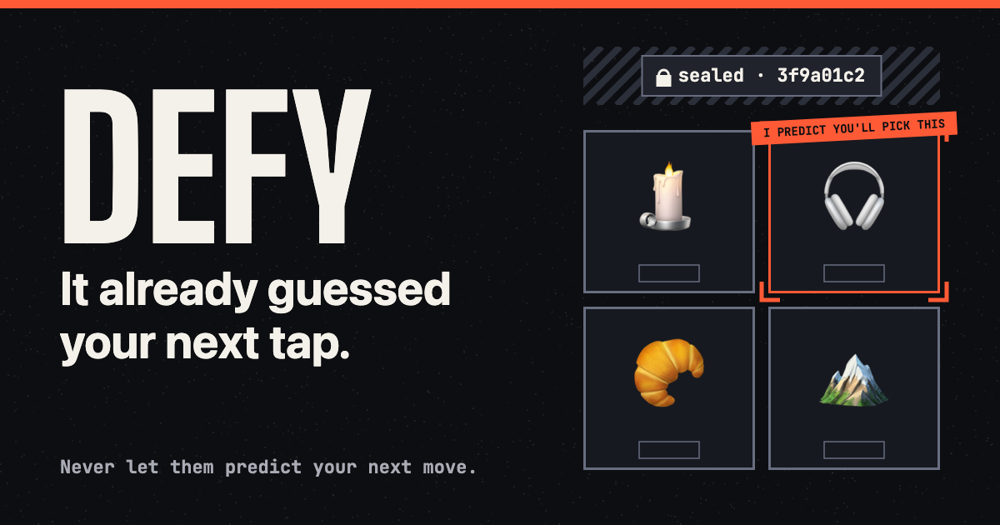
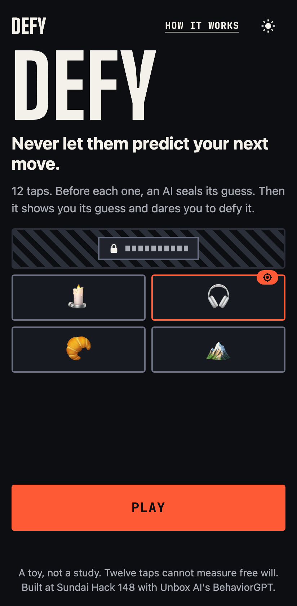
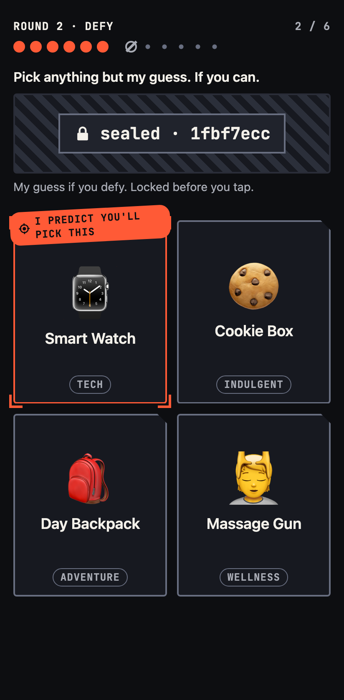
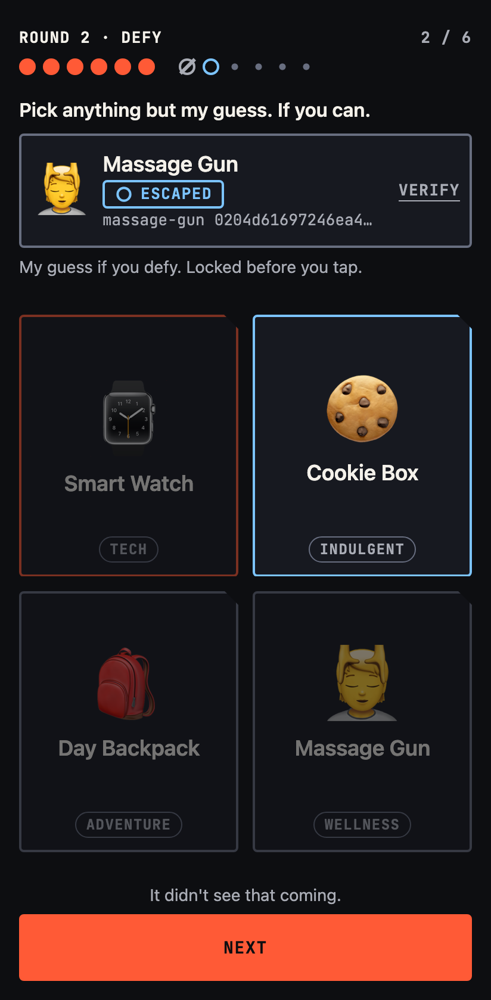
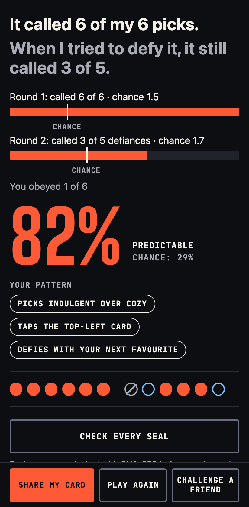
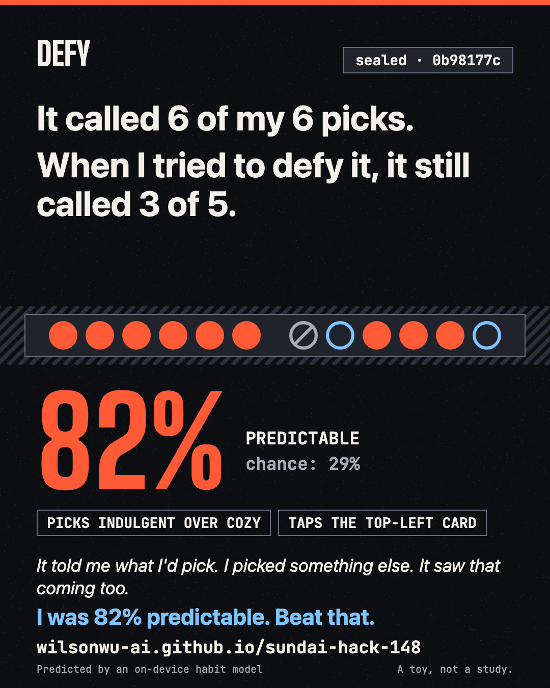

# DEFY

**A 60-second phone game where an AI predicts your next pick, shows you its guess, and dares you to pick something else.**

Never let them predict your next move.

Play it: https://wilsonwu-ai.github.io/sundai-hack-148/



## Play it in 60 seconds

1. Tap Play. Round 1 is 6 turns: pick the card you would actually want. Before each tap, the AI locks its guess behind a hash (a short fingerprint that cannot be changed later).
2. Round 2 is 6 more turns. Now the AI shows you its guess, and you try to pick anything else. It also locks a second guess for what you will pick instead.
3. Read your result: how many picks it called, with chance beside every count, plus a share card and a panel to check every seal yourself.

## Situation

The theme of Sundai Club Hack 148 was behavioral models, with Unbox AI's BehaviorGPT-v4 as the sponsor model. Its paper describes a 12.5B-parameter model trained to predict the next event from 150 billion user actions ([S-1](https://research.unboxai.com/behaviorgpt-v4-one-large-behavioral-model.pdf), vendor numbers). It also gives the framing we build on: a language model captures how people describe the world, a behavioral model captures how they act in it ([S-4](https://research.unboxai.com/behaviorgpt-v4-one-large-behavioral-model.pdf)).

Others have built prediction toys. The Aaronson Oracle guesses which of two keys you will press next ([R1-F17](https://people.ischool.berkeley.edu/~nick/aaronson-oracle/)); Aaronson reports 70% to 80% on people trying to type randomly, his own claim, not independently tested ([R4-F4](https://github.com/elsehow/aaronson-oracle)). Rigged Draw, an October 2026 Show HN, guesses your number picks and compares your score with 206 people from a psychology study ([R3-F15](https://zeli.app/story/50074909)).

The gap: every one predicts you blind. Nobody shows you the prediction and dares you to defy it. That is our best reading of our own search, not proof that nothing exists.

## Task

Build something viral, thought-provoking and honest, in one day, phone first. Viral means the hook lands in one glance and the result is worth posting. Honest means the score cannot be rigged and the page never overclaims.

## Action

- **Research with code quote-checks.** Every fact has an id in `research/verified.json`, and `scripts/quotecheck.py` checks each quote against its saved source. Only verified facts reach the product.
- **Nine concepts, scored blind.** A skeptic who saw only concept cards scored all nine. DEFY won with 44 of 55 (`research/PICK.md`).
- **A frozen spec.** `SPEC.md` fixes the rules, types, scoring formulas and file ownership.
- **A calibration that caught a weak model.** Our first habit model used one learning rate for every feature. In simulation, a player with perfectly consistent taste was called only 60.8% of the time on Round 1 turns 3 to 6. Separate rates per feature group raised that to 76.6%, while a random player stayed at chance (25.5% in Round 1 and 34.9% of Round 2 defiances, against 25% and 33.3%). Numbers: `research/calibration.md`.
- **A three-lens design council,** merged into `docs/design-spec.md`. Contrast was measured: body text on the dark background is 17.11 to 1, and every text pair is at least 4.5 (`research/design/contrast.md`). A colour-blind check made "you" ice blue, because the model's vermilion turns mustard under deuteranopia (a red-green colour vision type) and the other candidates turned yellow too.
- **Three parallel builders against frozen tests:** engine, screens and backend.

## Result

Tests: all 54 unit and simulation cases pass, the TypeScript strict typecheck is clean, and the full 12-tap browser flow passes on a Pixel 7 phone profile and on desktop Chrome: seals checked in the browser, no guessed item in the page before the tap, no console errors (5 of 5 browser checks; the phone-only tap-size check is skipped on desktop). The production build ships 17 kB of gzipped JavaScript. Full record: `research/qa/test-output.txt`.

Honesty simulation:

| Simulated player (200 games each) | What is counted | Called | Chance | Bar the test sets |
|---|---|---|---|---|
| Consistent taste | Round 1, turns 3 to 6 | 76.6% | 25% | at least 65% |
| Always taps the same corner | Round 1, turns 3 to 6 | 92.3% | 25% | at least 75% |
| Taps at random | Round 1, all turns | 23.0% | 25% | within 6 points |
| Taps at random | Round 2 defiances (900) | 33.0% | 33.3% | within 6 points |
| Defies with their next favourite | Round 2 defiances | 73.5% | 33.3% | at least 60% |

Measured by `tests/unit/frozen/simulation.test.ts` against the shipped catalog and model.

Screenshots:

<p>




</p>



## Why it can't be rigged

Before any card is tappable, the game picks the AI's guess, then computes a SHA-256 hash (a standard one-way fingerprint function) of the guess plus a random 32-character salt. Only the first 8 characters show, on a face-down card. After your tap, the card flips and reveals the guess and the salt. You can recompute the hash in the verify panel, and the guessed item is never in the page before your tap.

The second check is a test. In a frozen simulation of 200 games per simulated player (`SPEC.md` A2, `tests/unit/frozen/simulation.test.ts`), a player who taps at random must land within 6 points of chance: 25% in Round 1 and 33.3% of defiances in Round 2. A player with a real pattern gets called more. The score is earned, not handed out.

## Why this matters

- A 2026 study of 1,305 people ([R3-F13a](https://arxiv.org/abs/2603.28944)) found that over 40% treated an AI as an authority on their own behavior ([R3-F13](https://arxiv.org/abs/2603.28944)). Round 2 lets you test that on yourself.
- The same paper suggests that seeing a prediction may narrow the futures people consider ([R3-F14](https://arxiv.org/abs/2603.28944)).
- A well-known 93% figure for how predictable human movement is ([R1-F13](https://pubmed.ncbi.nlm.nih.gov/20167789/)) is an upper bound from information theory, not what any model achieved. DEFY shows only counts from your own run, beside chance.
- The sponsor paper notes that predicting human actions touches privacy, consent and power gaps between organizations and individuals ([S-10](https://research.unboxai.com/behaviorgpt-v4-one-large-behavioral-model.pdf)). A game where you can see and test the prediction is one small answer.

## How it works

The habit model runs in your browser. It scores each of the four cards from its vibe, price, tone and screen position, whether it repeats the spot or vibe of your last pick, and, in Round 2, how far its vibe sits from the card it showed you. It starts with a slight pull to the top-left card and a strong push away from the card it showed. After every tap it nudges its weights toward what you picked, with taste learning fastest. In Round 2 its sealed defiance guess is its favourite among the three cards it did not show.

When the backend is on, a small Cloudflare Worker (a tiny server at the network edge) sends your picks so far to BehaviorGPT and gets scores for the four cards. The API key stays on that server, as the terms require ([R2-F12](https://portal.unboxai.com/terms/)). Those scores are blended with the habit model's. If the live model is slow or fails, that turn uses the habit model, and the result screen says which engine answered.

Without the backend, the game still works on the habit model alone. You lose the live counter and the percentile, and the card compares you with chance. A percentile appears only once at least 20 players have finished.

## Privacy

Your taps stay in your browser. When the live model is on, each turn sends only item ids, your timezone and a random session id to our server, and your final counts are saved anonymously for the histogram. No IP address is ever written to storage.

## Run locally

```
npm install
npm run dev
npm test
npm run test:e2e
```

## Deploy

The static site goes to GitHub Pages. The optional backend lives in `worker/`; setup steps are in [worker/README.md](worker/README.md).

## Credits

Unbox AI's BehaviorGPT, and Sundai Club Hack 148.

## License

MIT. See [LICENSE](LICENSE).

A toy, not a study. Twelve taps cannot measure free will. · Built at Sundai Hack 148 with Unbox AI's BehaviorGPT.
